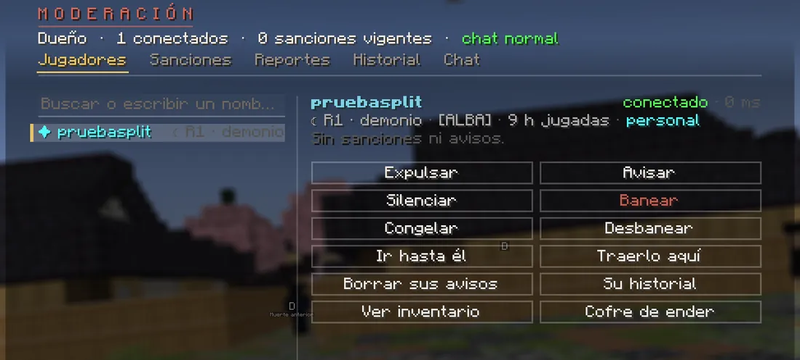
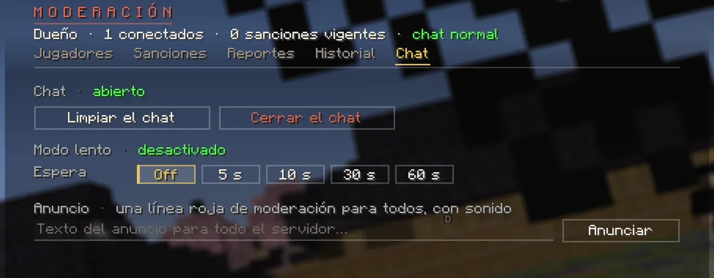

# La ventana de moderación

Escribe **`/mod`** (o `/moderacion`) sin nada más. Arriba ves tu papel (**Moderador**), cuántos jugadores hay conectados,
cuántas sanciones están en vigor, cómo está el chat y, si estás en creativo o en espectador, ese modo. Con ++left++ y
++right++ cambias de pestaña y con ++esc++ la cierras.

La ventana tiene cinco pestañas: **Jugadores**, **Sanciones**, **Reportes**, **Historial** y **Chat**. No se corta ningún
texto: lo que no cabe en su sitio se lee entero al pasar el ratón por encima, y con la rueda bajas por las listas largas.

## Jugadores

A la izquierda, un buscador y los conectados. Al elegir a alguien sale su **ficha**: rango, bando, clan, ping, horas
jugadas y, en una línea, sus avisos, si está silenciado (hasta cuándo y por qué) y si está congelado. Debajo, tres
pestañas:

- **Herramientas**: todos los botones ([abajo](#las-herramientas)).
- **Avisos** (con su número): **cada aviso entero**, con quién lo puso, cuándo y por qué, los más nuevos arriba.
- **Registro**: todo lo que dice de él el historial guardado del servidor: lo que le ha hecho el staff (sanciones, avisos,
  objetos retirados…) y, si es del staff, también lo que ha hecho él. **Míralo antes de sancionar.**

<figure markdown="span">
  { width="760" loading=lazy }
  <figcaption>Los botones de la ficha (la pestaña Herramientas). La captura es de antes de la actualización 1.4, sin las tres pestañas de la ficha, y la ventana la abre el dueño; en la tuya pone «Moderador».</figcaption>
</figure>

### Las herramientas

- **Alguien que no está conectado**: escribe su nombre completo en la búsqueda y pulsa ++enter++. Así puedes banearle,
  levantar su baneo, leer sus avisos y su registro o mirar su inventario aunque no esté.
- **Silenciar** y **Banear**: eliges la duración (10 min, 1 h, 6 h, 1 d, 7 d o 30 d) y escribes el motivo, que se le
  muestra al jugador. Si ya está silenciado, en vez de Silenciar sale el botón para quitarle el silencio.
- **Expulsar** (solo si está conectado): escribes el motivo.
- **Avisar**: un aviso formal, siempre con motivo. Tres avisos en una semana le silencian una hora automáticamente.
- **Congelar**: no se mueve, no pega, no recibe daño ni usa nada; solo puede hablar.
- **Ir hasta él** y **Traerlo aquí** (para traerle tienes que estar pisando suelo: ni volando ni en espectador).
- **Borrar sus avisos** y **Su historial** (te lleva al [Historial](#historial) con solo lo suyo, lo mismo que su
  Registro).
- **Ver inventario** y **Cofre de ender** ([abajo](#su-inventario-y-su-deposito)).

### Tu modo de juego

Al abrir la ventana, antes de elegir a nadie, a la derecha salen tus [topes](limites.md#tus-topes) y, abajo, **Tu modo de
juego** con tres botones: **Supervivencia**, **Creativo** y **Espectador** (el tuyo, marcado). Hacen lo mismo que
[`/gamemode`](comandos.md#tu-modo-de-juego): el creativo es el **vigilado** ([sus límites](limites.md#en-creativo)) y el
espectador, el de `/espectador`. Si el dueño del servidor ha apagado el creativo de los moderadores, solo salen
Supervivencia y Espectador.

## Sanciones

Los baneos y silencios en vigor, con el botón **Levantar**. Solo puedes levantar los que pusiste tú (y los silencios
automáticos por avisos, que no son de nadie). El motivo se lee en varias líneas; si es muy largo, entero al pasar el
ratón.

## Reportes

Los reportes abiertos que han hecho los jugadores, con **Ir** (te lleva junto a quien han reportado) y **Cerrar**. Al
cerrarlo, a quien lo hizo le llega un aviso. Los detalles se leen como las sanciones: en varias líneas y, si son muy
largos, al pasar el ratón.

<figure markdown="span">
  { width="560" loading=lazy }
  <figcaption>Así reportan los jugadores (con /report o /reportar): a quién, el motivo y, si quieren, los detalles.</figcaption>
</figure>

Los motivos que pueden elegir son: insultos o acoso, trampas o hacks, griefing o robo, spam o publicidad, abuso de un fallo
u otro motivo. Cada jugador puede mandar un reporte por minuto (seis por hora).

## Historial

Las últimas 80 acciones del staff: quién hizo qué, a quién y por qué. Todo lo que haces sale aquí. Con un jugador
elegido, arriba a la derecha tienes dos botones: **Solo** con su nombre (por ejemplo «Solo Kaito22»: todo lo que dice de
él el historial guardado, como su Registro) y **Todo**.

## Chat

<figure markdown="span">
  { width="760" loading=lazy }
  <figcaption>Limpiar o cerrar el chat, el modo lento y los anuncios.</figcaption>
</figure>

- **Limpiar el chat** de todos.
- **Cerrar el chat** público (el staff sigue pudiendo hablar y los privados siguen funcionando) y volver a abrirlo.
- **Modo lento**: un mensaje cada 5, 10, 30 o 60 segundos (Off lo quita). Al staff no le afecta.
- **Anuncio**: una línea roja «⚠ MODERACIÓN» para todo el servidor, con sonido.

## Su inventario y su depósito

**Ver inventario** (o `/mod inventario <jugador>`) abre lo que lleva en un cofre; **Cofre de ender**, lo de su cofre de
ender.

- **Un clic en un objeto se lo retira** y lo guarda en su **depósito**, nunca en tu inventario. Nadie se queda con nada.
- **Solo mirar** si está desconectado (ves lo de su último guardado), si aún no ha iniciado sesión, si está en un duelo o
  si tú estás en espectador.
- **No se retira** lo que va con su historia: su katana y los objetos de misión (tampoco una mochila o caja que los
  lleve dentro). Eso solo lo puede tocar el dueño.
- **El depósito**: el botón de abajo a la derecha de esa vista (o `/mod deposito <jugador>`) enseña lo que se le ha
  retirado. **Un clic se lo devuelve**: a su inventario o, si no cabe o no está conectado, a su buzón del Mercado. Con
  `/mod devolver <jugador>` se le devuelve todo.

!!! warning "Retirar no es castigar"
    Retira algo solo si no debería tenerlo (por ejemplo, algo conseguido con un fallo del servidor) y avisa a un
    administrador de lo que has visto. Si te equivocas, devuélveselo.
